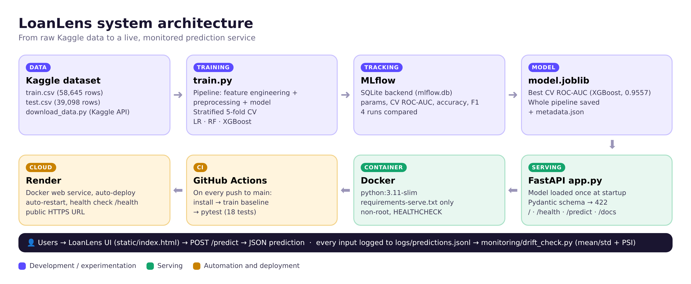
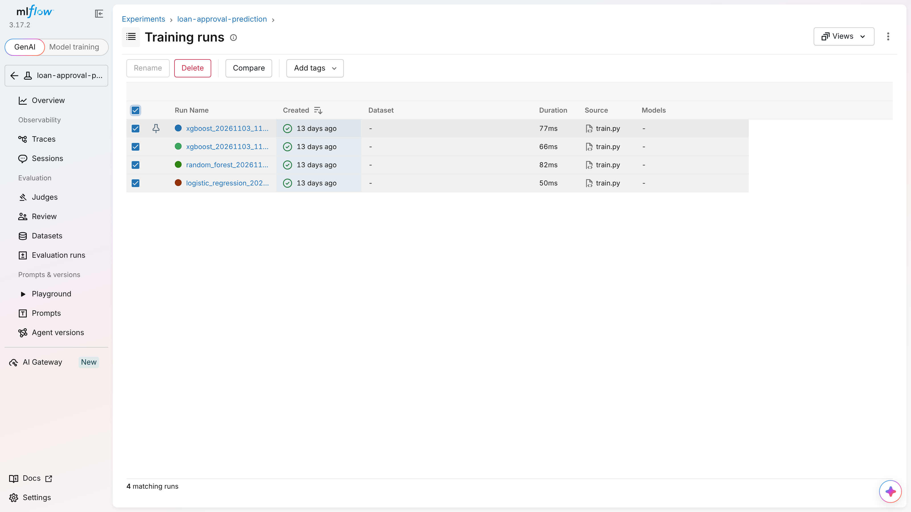
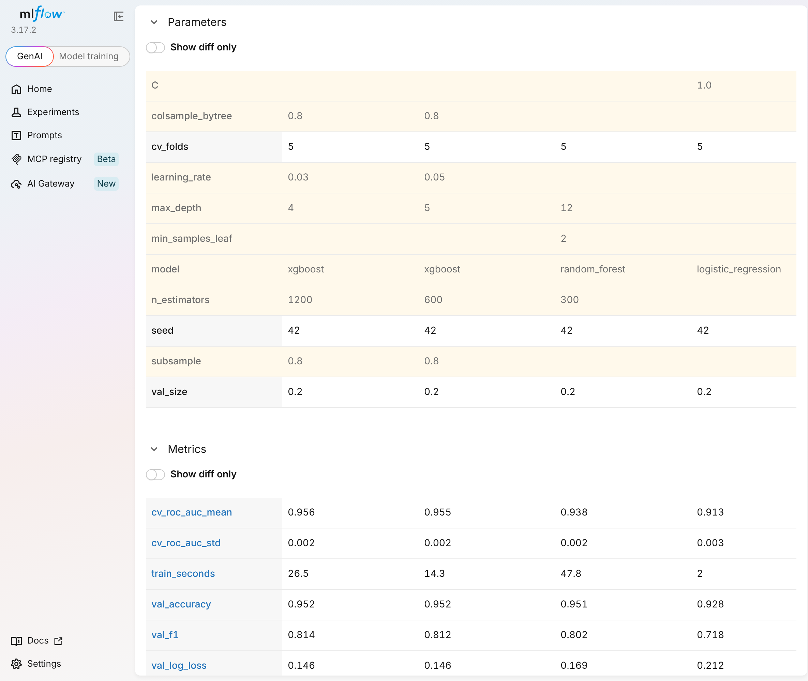
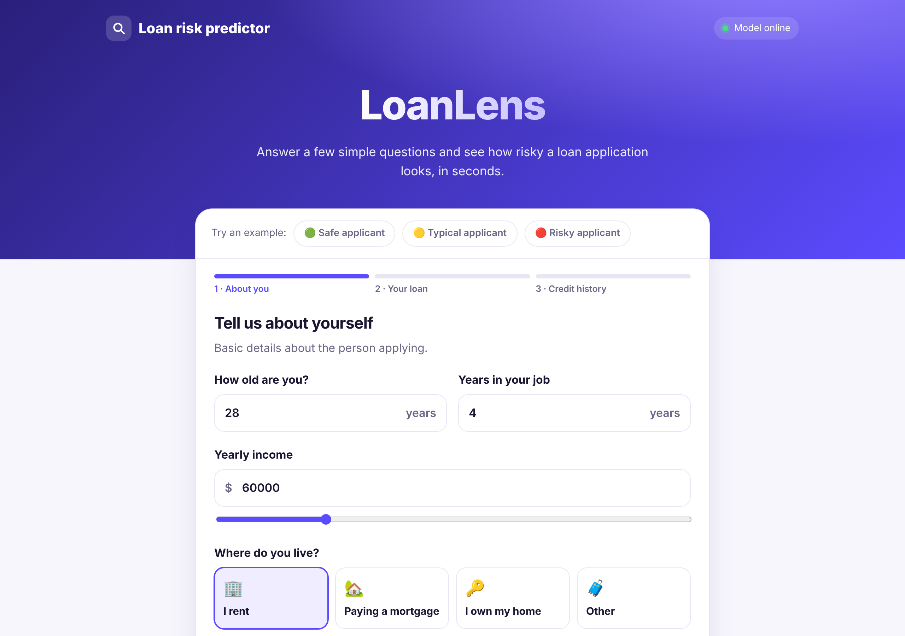
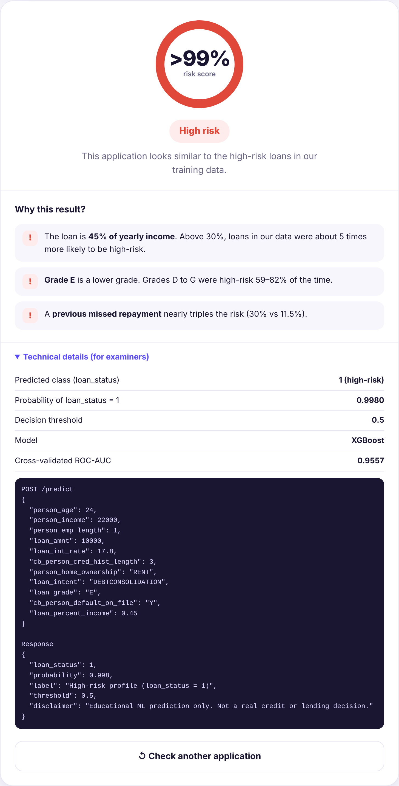
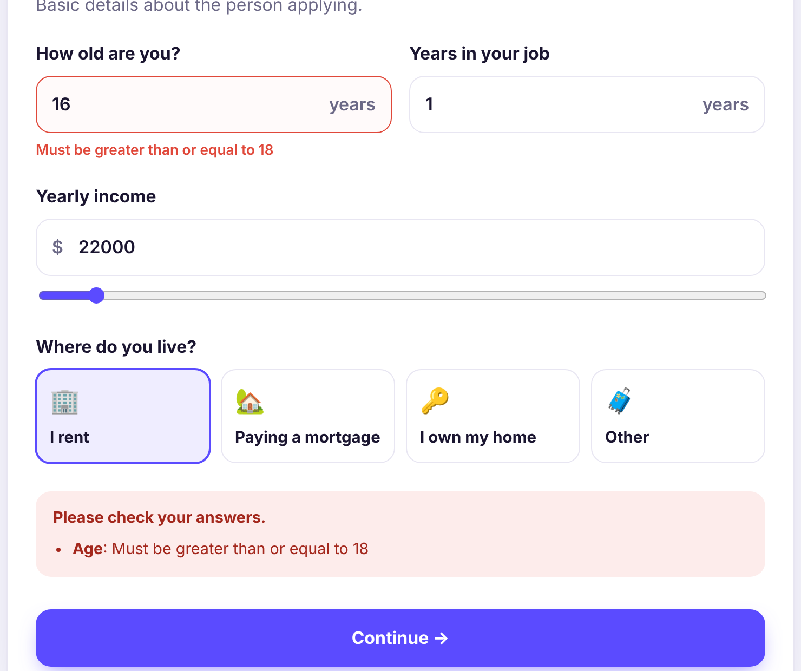
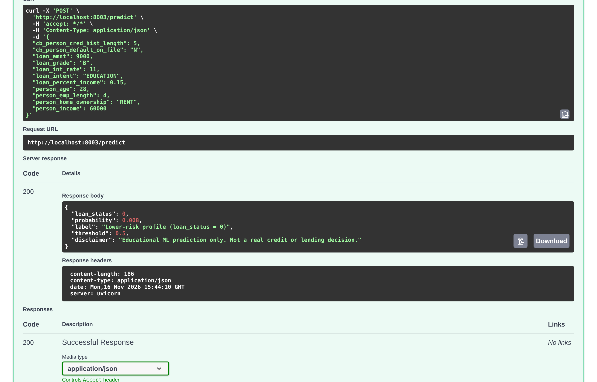
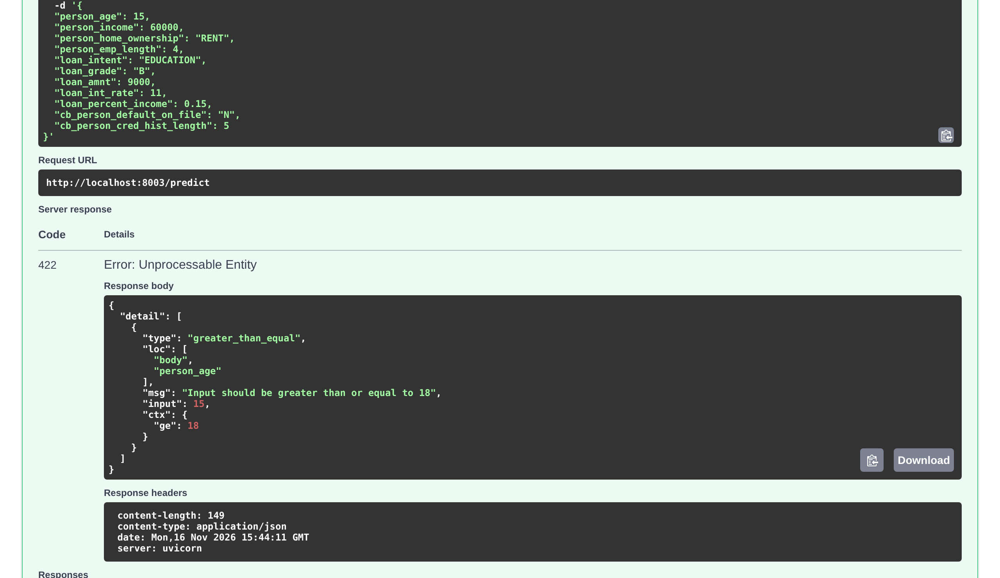
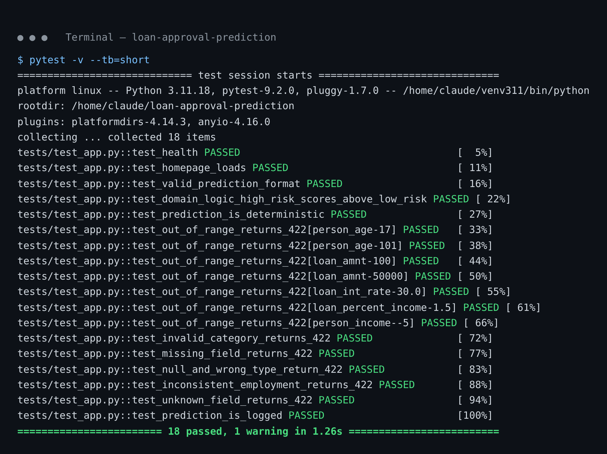
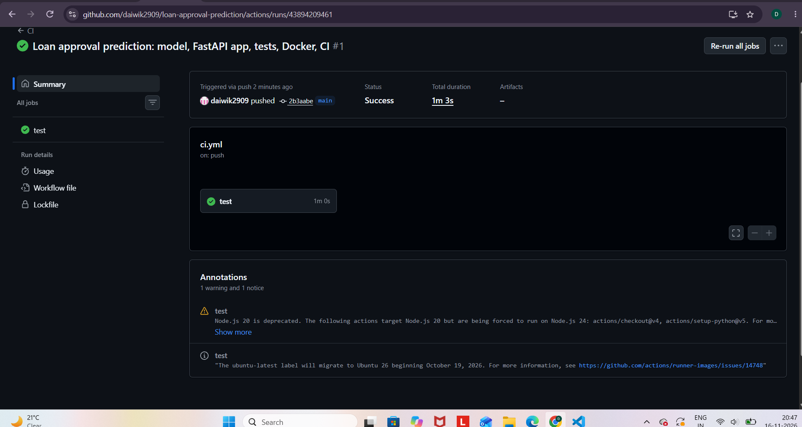

# Loan Approval Prediction Using Machine Learning and MLOps

CSL236 – Introduction to AI and Machine Learning · End-term project

An end-to-end ML system for the Kaggle competition
[Loan Approval Prediction ULIMA](https://www.kaggle.com/competitions/loan-approval-prediction-ulima).
It covers EDA, a cross-validated model comparison tracked in MLflow, a FastAPI + Pydantic service with an HTML
front end, pytest tests, a Docker image, GitHub Actions CI, cloud deployment and prediction logging with a drift check.

| | Link |
|---|---|
| Live app (LoanLens) | https://loan-approval-prediction-5d14.onrender.com |
| API docs (Swagger) | https://loan-approval-prediction-5d14.onrender.com/docs |
| Health check | https://loan-approval-prediction-5d14.onrender.com/health |
| GitHub repository | https://github.com/daiwik2909/loan-approval-prediction |
| CI run (passing) | https://github.com/daiwik2909/loan-approval-prediction/actions/runs/43897858771 |
| Project report (PDF) | https://github.com/daiwik2909/loan-approval-prediction/blob/main/docs/Daiwik_Dogra_24CSU048.pdf |
| Kaggle competition | https://www.kaggle.com/competitions/loan-approval-prediction-ulima |

[](https://github.com/daiwik2909/loan-approval-prediction/actions/workflows/ci.yml)

> **Educational project.** Predictions come from a model trained on a competition dataset. They are not a real
> lending decision and do not guarantee any outcome.

---



## 1. Problem statement

Given an applicant's personal, loan and credit-history details, predict `loan_status` (0 or 1).
This is supervised **binary classification** on tabular data. The competition is scored with **ROC-AUC** on the
predicted probability of `loan_status = 1`.

**What `loan_status = 1` means.** The competition is titled "loan approval", but in the training data class 1 goes
with *riskier* profiles: grades D–G (59–82% positive vs 5% for grade A), a previous default (30% vs 11.5%),
renting (22% vs 1.4% for owners) and loans above 30% of income (68–76%). This matches the original credit-risk
dataset this competition is based on, where 1 = default. The app therefore labels class 1 as a
**"high-risk profile"** rather than "approved".

## 2. Dataset

| File | Rows × columns | Notes |
|---|---|---|
| `train.csv` | 58,645 × 13 | 11 features + `id` + `loan_status` |
| `test.csv` | 39,098 × 12 | Same features, no target |
| `sample_submission.csv` | 39,098 × 2 | `id`, `loan_status` (probability) |

No missing values and no duplicate rows. Train and test have the same columns and the same category values.
Class balance: 85.76% class 0, **14.24% class 1** (8,350 rows).

**Source:** Kaggle competition *Loan Approval Prediction ULIMA*,
https://www.kaggle.com/competitions/loan-approval-prediction-ulima (public competition data). The three CSVs total
about 6 MB, well under the 50 MB limit, so they are committed in `data/raw/` and a fresh clone can train straight
away. `data/download_data.py` re-downloads them through the Kaggle API if needed.

## 3. Data contract

All API validation rules in `app.py` (`LoanApplication`) match this table. Requests outside it return **HTTP 422**.

| Feature | Type | Allowed range/values | Why it matters |
|---|---|---|---|
| `person_age` | int | 18–100 | Age; train has impossible values up to 123 (capped at 80 inside the model) |
| `person_income` | float | 1,000–2,000,000 | Lowest income quintile has a 30% class-1 rate, highest 4% |
| `person_home_ownership` | category | RENT, OWN, MORTGAGE, OTHER | Renters 22% class 1, owners 1.4% |
| `person_emp_length` | float | 0–60, and ≤ age − 14 | Longer employment, lower class-1 rate (corr −0.10) |
| `loan_intent` | category | EDUCATION, MEDICAL, PERSONAL, VENTURE, DEBTCONSOLIDATION, HOMEIMPROVEMENT | Rates range from 9% (VENTURE) to 19% (DEBTCONSOLIDATION) |
| `loan_grade` | category (ordered) | A, B, C, D, E, F, G | Strongest single signal: 5% (A) to 82% (G) |
| `loan_amnt` | float | 500–35,000 | Same as the training range |
| `loan_int_rate` | float | 5.0–25.0 (%) | Corr +0.34; rises with grade (7.3% avg for A, 20.3% for G) |
| `loan_percent_income` | float | 0–1 | Corr +0.38; jumps from 15% to 68% class 1 above 0.30 |
| `cb_person_default_on_file` | category | N, Y | Y: 30% class 1 vs 11.5% for N |
| `cb_person_cred_hist_length` | int | 0–60, and ≤ age − 14 | Almost no linear link to target (corr −0.003) |
| `loan_status` (target) | int | 0, 1 | 1 = high-risk profile; model outputs P(loan_status = 1) |

Extra fields, missing fields, `null` values and wrong types are rejected (422). The contract accepts **99.94%** of
real rows. The 0.06% it rejects are impossible records such as age 123 or employment longer than age − 14.

**Missing values (NaN).** The training data has none, so the API does not accept missing values. Any `null` or
missing field returns 422 before it reaches the model.

## 4. EDA findings

Run `python eda.py data/raw/train.csv`. It prints all tables below and saves charts to `reports/figures/`.

- **Imbalance:** 14.2% positives, so accuracy is misleading (always predicting 0 scores 85.8%). ROC-AUC is used instead.
- **Loan grade** separates the classes most strongly. Grades D–G make up only 10.6% of rows but have 59–82% class-1 rates.
- **Loan-to-income** has a threshold effect. The class-1 rate is 7–15% up to 0.30 and 68–76% above it.
- **Interest rate and grade overlap.** The mean rate rises steadily from A to G, so they share information.
- `loan_percent_income` ≈ `loan_amnt / person_income` in 96.3% of rows.
- **Weak features:** `person_age` and `cb_person_cred_hist_length` have near-zero correlation with the target.
- **Outliers:** age up to 123 (3 rows above 80), employment up to 123 years (2 rows above 60), income up to 1.9M.
  These are capped, not deleted.

Charts: `target.png`, `numeric_dist.png`, `categorical_target_rate.png`, `correlation.png`, `boxplots_by_target.png`.

## 5. Feature engineering

Implemented in `loan_features.py` as a scikit-learn transformer (`LoanFeatureEngineer`) inside the model pipeline.
Anything learned (the income cap, mean interest rate per grade) is learned in `fit()`, so each CV fold learns
only from its own training rows. **No validation or test information leaks into training.**

| Feature | Definition | Reason |
|---|---|---|
| `loan_to_income` | `loan_amnt / person_income` | Recomputed affordability ratio |
| `grade_num` | A→1 … G→7 | Grades are ordered |
| `rate_vs_grade` | interest rate − mean rate for that grade | Pricing that is unusual for the grade |
| `emp_to_age`, `cred_to_age` | years ÷ age | Career and credit maturity relative to age |
| `high_lti` | `loan_percent_income > 0.30` | Threshold effect seen in EDA |
| `log_income` | `log(1 + income)` | Reduces income skew for the linear model |
| caps | age ≤ 80, employment ≤ 60, income ≤ 99.5th percentile | Limits impossible or extreme values |

Categorical features are one-hot encoded (`handle_unknown="ignore"`). Numeric features are standardised for
logistic regression only.

**Ablation (honest result):** feature engineering raised logistic regression's CV ROC-AUC from **0.9012 to 0.9129**.
For XGBoost it made no meaningful difference (0.9559 without vs 0.9550 with, inside the ±0.002 CV noise), because
trees can learn ratios and thresholds on their own. The features are kept because they help the linear baseline
and make the model easier to explain.

## 6. Experiments (MLflow)

The setup is the same for every model: a stratified 80/20 split (seed 42), then **stratified 5-fold CV** on the
80%, then scoring on the untouched 20%. The final model is refit on all 58,645 rows.

| Run | Algorithm | Key hyperparameters | CV ROC-AUC (mean ± std) | Val ROC-AUC | Val accuracy | Val F1 |
|---|---|---|---|---|---|---|
| 1 | Logistic Regression (baseline) | C=1.0 | 0.91292 ± 0.00292 | 0.91507 | 0.9275 | 0.7176 |
| 2 | Random Forest | 300 trees, max_depth=12, min_samples_leaf=2 | 0.93818 ± 0.00185 | 0.93658 | 0.9510 | 0.8022 |
| 3 | XGBoost | 600 trees, max_depth=5, lr=0.05 | 0.95498 ± 0.00199 | 0.95826 | 0.9520 | 0.8119 |
| 4 | **XGBoost (selected)** | 1200 trees, max_depth=4, lr=0.03 | **0.95566 ± 0.00193** | 0.95793 | 0.9524 | 0.8136 |

**Model selection:** XGBoost run 4 has the highest **CV** ROC-AUC, which is the selection criterion because it
averages 5 folds and is more stable than one validation split. Runs 3 and 4 are within noise of each other.
Both beat random forest by about 0.017 and the baseline by about 0.043.

Reproduce:

```powershell
python train.py --model logistic_regression --C 1.0
python train.py --model random_forest --n_estimators 300 --max_depth 12 --min_samples_leaf 2
python train.py --model xgboost --n_estimators 600 --max_depth 5 --learning_rate 0.05
python train.py --model xgboost --n_estimators 1200 --max_depth 4 --learning_rate 0.03
mlflow ui --backend-store-uri sqlite:///mlflow.db     # open http://127.0.0.1:5000
```

Each run logs algorithm, hyperparameters, CV mean/std, validation ROC-AUC, accuracy, precision, recall, F1, log
loss and training time. `train.py` saves `model/model.joblib` (plus `model/metadata.json`) only when the run beats
the saved model's CV ROC-AUC (`--save always` forces it). No personal data is logged to MLflow.





**Submission files:** each `train.py` run also writes a Kaggle-format prediction file (`id`, `loan_status` probability
for all 39,098 test rows) to `submissions/`, validated against `sample_submission.csv`.

## 7. Installation

Linux / macOS:

```bash
git clone https://github.com/daiwik2909/loan-approval-prediction.git
cd loan-approval-prediction
python3 -m venv venv && source venv/bin/activate
pip install -r requirements.txt
python train.py                      # baseline run on the committed data, logged to MLflow
```

Windows PowerShell:

```powershell
git clone https://github.com/daiwik2909/loan-approval-prediction.git
cd loan-approval-prediction
py -3.11 -m venv venv
.\venv\Scripts\Activate.ps1
pip install -r requirements.txt
python train.py
```

`python train.py` with no arguments trains the logistic-regression baseline. It replaces `model/model.joblib` only if
its CV ROC-AUC beats the saved model. Optional: `kaggle auth login` then `python data/download_data.py --force`
re-downloads the data through the Kaggle API.

## 8. Running locally

```powershell
uvicorn app:app --reload          # http://127.0.0.1:8000  (UI)   /docs (Swagger)
pytest -v --tb=short              # 18 tests
python monitoring\drift_check.py  # after some predictions have been logged
```

## 9. API

| Method | Route | Description |
|---|---|---|
| GET | `/` | Web UI (`static/index.html`) |
| GET | `/health` | `{"status":"ok","model_loaded":true,"model":"xgboost","cv_roc_auc":0.9557}` |
| POST | `/predict` | Validated applicant JSON in, prediction out |
| GET | `/docs` | Swagger UI |

```json
POST /predict
{"person_age":28,"person_income":60000,"person_home_ownership":"RENT","person_emp_length":4,
 "loan_intent":"EDUCATION","loan_grade":"B","loan_amnt":9000,"loan_int_rate":11,
 "loan_percent_income":0.15,"cb_person_default_on_file":"N","cb_person_cred_hist_length":5}

-> {"loan_status":0,"probability":0.008,"label":"Lower-risk profile (loan_status = 0)",
    "threshold":0.5,"disclaimer":"Educational ML prediction only. Not a real credit or lending decision."}
```

The model is loaded **once** at startup (FastAPI `lifespan`), never inside `/predict`.











## 10. Tests

`tests/test_app.py` has **18 tests** (12 functions, one parametrised over 7 cases):

| Area | Tests |
|---|---|
| Health check | `/health` returns ok and `model_loaded: true` |
| UI | `/` returns HTML |
| Prediction format | keys, 0 ≤ probability ≤ 1, label consistent with threshold |
| Domain logic | a high-risk profile (grade G, renter, prior default, loan = 50% of income) scores > 0.3 above a low-risk one (grade A, owner, loan = 5% of income) |
| Determinism | the same input gives the same output |
| Boundary validation (422) | age 17/101, loan 100/50,000, rate 30%, ratio 1.5, negative income |
| Invalid input (422) | bad category, missing field, `null`, wrong type, employment > age − 14, unknown extra field |
| Logging | each prediction appends one JSON line |

The domain test checks only the **order** of two extreme profiles, built from EDA rates, with a margin. It does not
assume any single feature guarantees an outcome, because tree models are not monotonic feature by feature.



## 11. Docker

```powershell
docker build -t loan-approval-prediction .
docker run -d -p 8000:8000 --restart unless-stopped --name loan-api loan-approval-prediction
curl http://localhost:8000/health
docker logs loan-api
```

The image is built from `python:3.11-slim` with `requirements-serve.txt` only (no MLflow, pytest or plotting). It
runs as a non-root user, has a `HEALTHCHECK`, and reads `$PORT` (default 8000) so cloud platforms can set the port.
Image size: _TODO_ MB (run `docker images loan-approval-prediction`).

## 12. CI (GitHub Actions)

`.github/workflows/ci.yml` runs on every push and pull request to `main`:

1. Checks out the code and installs Python 3.11 and `requirements.txt`.
2. Gets data: if the `KAGGLE_API_TOKEN` secret exists, it downloads the real data. Otherwise it generates a small
   **synthetic** fixture (`data/make_ci_fixture.py`), used only to prove `train.py` runs end to end.
3. Trains a baseline logistic regression into `/tmp` (the committed model is not overwritten).
4. Runs `pytest` against the committed `model/model.joblib`.

Optional secret: GitHub repo → Settings → Secrets and variables → Actions → New secret `KAGGLE_API_TOKEN`. GitHub
masks secrets in logs.

**Latest passing run:** https://github.com/daiwik2909/loan-approval-prediction/actions/runs/43897858771 (completed in about 1 minute)



## 13. Deployment

**Live URL:** https://loan-approval-prediction-5d14.onrender.com · **Swagger:** https://loan-approval-prediction-5d14.onrender.com/docs · **Health:** https://loan-approval-prediction-5d14.onrender.com/health

Deployed on Render (free tier, Singapore region) as a Docker web service built from this repository's `Dockerfile`, with health check path `/health` and auto-deploy on every push to `main`.

Render (free tier): push the repo to GitHub → Render → New → Web Service → connect the repo → Runtime **Docker** →
Instance type Free → Health check path `/health` → Deploy. Render sets `$PORT`, which the Dockerfile reads. Restart
on failure is automatic and logs are on the service's **Logs** tab. The free tier sleeps after inactivity, so the
first request can take about a minute.

## 14. Monitoring

Every `/predict` call appends one JSON line (request id, timestamp, the 11 inputs, probability, class) to
`logs/predictions.jsonl`. No names, IDs or IP addresses are stored. A real sample log of 25 API calls is committed as
`monitoring/sample_predictions.jsonl`.

`monitoring/drift_check.py` (bonus) compares logged inputs with the training data. It prints the **mean and standard
deviation** of every numeric input for training vs live data, then the **Population Stability Index** per feature
(PSI < 0.10 stable, 0.10–0.25 moderate, > 0.25 drift). It needs a few hundred logged rows to be reliable.

```powershell
python monitoring\drift_check.py --log monitoring\sample_predictions.jsonl
``` If key features drift or the live positive rate
moves away from 14%, the model should be re-validated and retrained.

On Render's free tier the log file is lost when the service restarts. A production system would send logs to a
database or object storage.

## 15. Repository structure

```
loan-approval-prediction/
├── data/raw/                    train.csv, test.csv, sample_submission.csv (Kaggle, about 6 MB)
├── data/download_data.py        Kaggle API download + verification
├── data/make_ci_fixture.py      synthetic CI data (not used for scores)
├── model/model.joblib           trained pipeline (preprocessing + XGBoost)
├── model/metadata.json          params, metrics, versions of the saved model
├── static/index.html            web UI
├── tests/test_app.py            18 pytest tests
├── monitoring/drift_check.py    drift report: mean/std + PSI vs training data
├── monitoring/sample_predictions.jsonl   sample prediction log (25 real API calls)
├── docs/                        screenshots and architecture diagram
├── .github/workflows/ci.yml     CI pipeline
├── app.py                       FastAPI service
├── train.py                     training + CV + MLflow
├── loan_features.py             shared feature definitions + transformer
├── eda.py                       EDA tables and charts
├── Dockerfile, .dockerignore
├── requirements.txt             full dev environment
├── requirements-serve.txt       production image only
└── mlflow.db                    MLflow experiment history
```

## 16. Team

| Member | Roll number | Contribution |
|---|---|---|
| Daiwik Dogra | 24CSU048 | Dataset selection and EDA, feature engineering (`loan_features.py`), training pipeline and MLflow experiments (`train.py`), model selection, report |
| Madhav Sharma | 24CSU117 | FastAPI service and Pydantic data contract (`app.py`), LoanLens UI, pytest suite, Dockerfile, GitHub Actions CI, Render deployment, prediction logging and drift check, presentation |

Both members worked on the README and can run and explain every stage.

## 17. Limitations

- The meaning of `loan_status` is inferred from the data patterns (see section 1) and should be confirmed.
- The decision threshold is fixed at 0.5. A real lender would choose it from the cost of each error type.
- The data is a competition dataset. Scores may not transfer to real applicants or to other countries.
- `loan_percent_income` is supplied by the client. The UI computes it from amount and income, but API callers could send inconsistent values.
- Prediction logs on free hosting are not persistent.

## 18. Future scope

- CatBoost/LightGBM and an ensemble; treating numeric features as categories (common in this competition series).
- Hyperparameter search (Optuna) logged to MLflow.
- SHAP explanations per prediction in the UI.
- Persistent logging (PostgreSQL or S3) and a scheduled drift job that triggers retraining.
- Probability calibration and a cost-based threshold.
